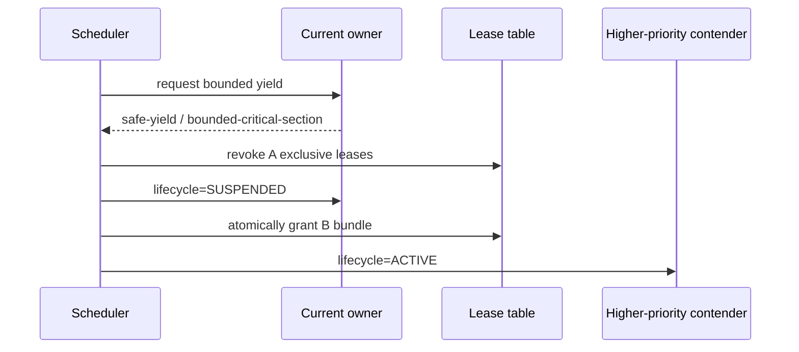
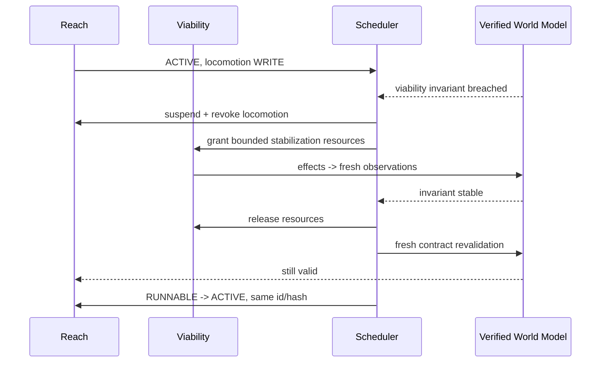
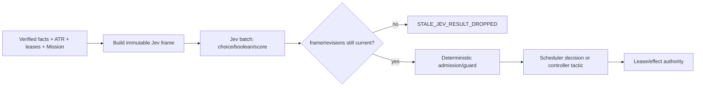
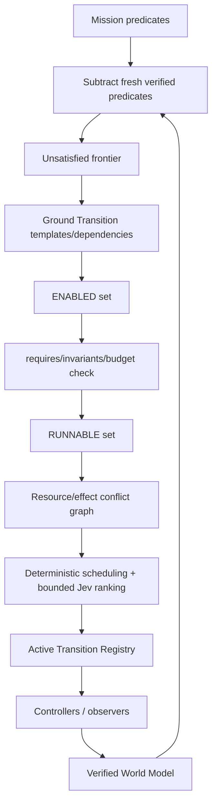

# NEW ARCHITECTURE V4.1.1 — Concurrent Verified Transition Runtime

> **Superseded by `docs/architecture/NEW-ARCHITECTURE-V4.1.2.md`.** Retained as semantic lineage (root `AGENTS.md` §0 precedence item 4), not as current instruction.

Status: architecture contract and executable model, not production migration.
V4.1 base: `cea0237702bedd8c978b63879b7b3fa13b25065c`; original repository audit base: `origin/main` at `355a26796c4891ecf68ab8ef70cfdd2b626df225`, with the Reach VTR acceptance integration read-only snapshot noted by V4.1.
Fresh V4.1.1 worktree: `/home/s0u7a/vtr-worktrees/v411-model-hardening-20260925-2203`.
Branch: `arch/v4.1.1-model-hardening-20260925`.

This document is standalone. It does not assume V4 is correct; it preserves only properties that survived repository, runtime, concurrency, control, and Minecraft-specific review.

## 0.1 V4.1.1 hardening delta

V4.1.1 is a model-hardening revision before production migration. It closes ten executable-spec gaps found by adversarial review of V4.1: hierarchical resource overlap, typed resume proof, contract-bound VERIFY, mission/registry resume fencing, monotonic fact revision, transactional safe-yield preemption, bounded non-preemptible sections, full Jev binding equality, world/generation/lease/effect-bound commit tokens, and revisioned ATR mutation APIs. The semantic architecture is unchanged; the executable contract is stricter.

A boolean such as `freshRevalidation=true` is not evidence. Resume/VERIFY now require typed proof whose exact contract identity, live world, live runtime binding, predicate evidence revision/world, witness revision, and Mission/registry authorization are mechanically checked.

## 1. Problem statement

A long-running Minecraft agent is not a serial action classifier. It is a hybrid control system with asynchronous server truth, partial observation, irreversible effects, continuous body mechanics, moving entities, long-running world processes, health/hunger/air constraints, and multiple simultaneously relevant desired predicates.

V4 correctly moved the semantic unit from primitive action to verified world-state Transition, but its first Reach slice still has a single-active-Transition bias: one controller, one active contract, one body owner, and safety interruption as a terminal outcome. V4.1/V4.1.1 remove that bias without turning the runtime into a general-purpose operating system.

The central requirement is: **multiple semantic Transitions may remain live concurrently, while only compatible effects/resources may execute concurrently, and temporary mechanical preemption must not silently destroy semantic ownership.**

## 2. Design goals

1. Preserve deterministic world truth and deterministic SUCCESS.
2. Make multiple live Transitions a first-class runtime concept.
3. Separate semantic ownership, resource ownership, and effect authorization.
4. Separate mechanical, tactical, transition-policy, and strategic timescales.
5. Make Viability a bounded concurrent runtime, not a queue side quest or superuser.
6. Preserve Transition identity across legitimate suspension and runtime-generation rebinding.
7. Make stale decisions/effects fail closed.
8. Keep Jev strong as the primary fast semantic policy without giving it truth, lease, or actuator authority.
9. Keep System2 sparse and off the scheduler hot path.
10. Make concurrency behavior deterministic enough to replay and test.

## 3. Non-goals

V4.1.1 is not a production Reach rewrite, not a benchmark-specific planner, not a huge God Scheduler, not a universal lock manager, and not a claim that every Minecraft activity should be a separate Transition. It does not replace Mineflayer mechanical control, and it does not make Jev or System2 responsible for Minecraft truth.

It also does not promise maximal parallelism. Concurrency is admitted only when resource/effect claims are compatible and observation/verification remain causally attributable.

## 4. Architecture overview

Canonical flow:

`Mission predicates -> verified unsatisfied frontier -> Transition proposals -> enabled graph -> Active Transition Registry -> deterministic resource/effect scheduler -> persistent controllers -> runtime adapters -> Minecraft -> fresh verified facts -> VERIFY -> frontier recomputation`

Parallel planes:

- **Verified World Model** owns observed truth and provenance.
- **Active Transition Registry (ATR)** owns semantic liveness and lifecycle.
- **Resource/Effect Scheduler** owns temporary execution rights.
- **Persistent Controllers** own contract-local tactical adaptation.
- **Mechanical Controllers** own fast body/device loops.
- **Viability Runtime** owns bounded stabilization incidents.
- **Jev Decision Plane** supplies grounded fast semantic judgments.
- **System2** synthesizes/repairs graph structure sparsely.
- **Journal** records global and per-Transition causal order.

No layer may infer SUCCESS from “an action returned successfully.”

## 5. Verified World Model

Facts are typed, provenance-bearing, time-stamped, world-scoped, and revisioned. `UNKNOWN`, absence, stale observation, and sensor error are not collapsed. Each accepted fact advances a monotonic `factRevision`; model decisions and irreversible-effect commit tokens bind to that revision.

World identity is `{serverId, dimension, worldEpoch}`. `generationId` is deliberately **not** part of semantic world identity: a hot reload may replace the controller generation without changing the world. Generation is a runtime binding/fence and requires fresh revalidation before resumed actuation.

## 6. Desired Predicate Model

Desired state has four distinct levels and they must not be conflated:

- **Mission predicate**: externally meaningful objective, e.g. `inventory(log-class)>=3`.
- **Transition predicate**: one causal step whose verified truth advances the Mission graph.
- **Tactical target/witness**: replaceable grounding such as one tree, entity, station, or waypoint.
- **Mechanical setpoint**: short-lived body target such as yaw, velocity, path node, or interaction face.

Invariants constrain all levels but are not goals. A witness can disappear without changing semantic identity when the contract permits substitution.

## 7. Causal Transition Graph

The graph is derived from unsatisfied predicates and verified dependencies. Nodes are Transition templates/contracts; edges express verified prerequisite relationships, not queue order. A node may be ENABLED while another is ACTIVE. A node may also remain OBSERVING after its body work has finished, as with smelting or waiting for a portal/server response.

Composition rule: create a child Transition only when it needs independent lifecycle, scheduling, resource ownership, or verification. Keep a tactic inside the parent controller when it stays inside the same desired predicate, effect envelope, risk/resource budget, and verification boundary.

Thus `Acquire(log,3)` may compose Search/Reach/Dig/Pickup as child Transitions when they need independent ownership, but a Reach detour or local jump normally remains controller-internal.

## 8. Transition Contract

A canonical contract contains semantic identity and bounds: `transitionId`, `contractHash`, family/class, world identity, desired predicate, requires, invariants, resource claims, allowed effects/scopes, budgets, progress definition, verification definition, and typed terminal outcomes.

**The contract hash excludes temporary leases, controller generation, scheduler epoch, current witness, current waypoint, and fact revision.** Those are runtime bindings. This is required for legitimate suspend/resume and generation rebinding without semantic identity laundering.

Irreversible effects are two-stage: the contract admits an effect class/scope; immediately before dispatch, the runtime issues a short-lived `EffectCommitToken` bound to transition, contract, world identity, exact runtime binding (generation/fact/registry/Mission revisions), current lease fingerprint, exact effect permit, and expiry. Any binding/world/lease/permit change or cancellation invalidates an unused token.

## 9. Transition Lifecycle

The lifecycle is deliberately small:

`ENABLED -> RUNNABLE -> ACTIVE -> {SUSPENDED | OBSERVING | BLOCKED | TERMINAL}`

- **ENABLED**: graph prerequisites make the Transition relevant, but admission has not yet run.
- **RUNNABLE**: contract is valid and could run if required resources are granted.
- **ACTIVE**: controller may execute effects for currently held leases.
- **SUSPENDED**: semantic ownership survives temporary preemption/rebinding; no actuation resources are held.
- **OBSERVING**: body actuation is unnecessary; Transition waits on fresh environmental/process evidence.
- **BLOCKED**: a named dependency/resource/policy/observation is missing; no busy retry.
- **TERMINAL**: one typed outcome has closed the instance.

`SUSPENDED`, `OBSERVING`, and `BLOCKED` are not failures. Resume always rechecks world identity, invariants, prerequisites, deadline/budget, witness validity, and runtime binding before resource acquisition.

## 10. Active Transition Set

The ATR is the authoritative set of nonterminal Transition instances. It stores per-instance contract identity, lifecycle, runtime binding, budgets/usage, progress state, and terminal handoff state. It does **not** imply that every resident Transition holds a body lease.

Multiple active/observing Transitions are normal: Reach + passive Search, exploration + smelting observation, combat threat tracking + navigation, or world-model appenders alongside a foreground mission.

ATR mutations occur only through revisioned put/mutate/remove APIs and advance `registryRevision`. A mutation cannot change a live Transition's `transitionId` or `contractHash`. Jev frames, resume proofs, VERIFY proofs, and effect commits bind to registry/fact/Mission revisions so late artifacts cannot be applied to a different active set.

## 11. Resource / Effect Ownership

V4.1 uses a small hierarchical namespace rather than a global mutex: `body.locomotion`, `body.orientation`, `interaction`, `attack`, `inventory`, `equipment`, `world.blocks`, `entity:<id>`, `observation.world`, `memory.worldModel`, `station:<identity>`, `container:<identity>`, and `command`.

Modes are `SHARED_READ`, `APPEND`, and `EXCLUSIVE_WRITE`. APPEND is permitted only on append-only/merge-defined stores such as observation journals; it is not generic shared mutation. Exclusive WRITE conflicts with any other claim on an overlapping hierarchical resource path. `body` overlaps `body.locomotion`; `inventory` overlaps `inventory.slot.*`; `station:furnace` overlaps a concrete `station:furnace@...`. Sibling paths do not overlap unless an ancestor is claimed.

Resource keys are parsed as canonical paths and conflict by ancestor/descendant overlap, not raw string equality. Claims are acquired as one canonical bundle, ordered by resource key, or not acquired at all. Controllers never hold resource A while waiting for B. This removes hold-and-wait deadlock from the normal path. Long waits must release scarce leases and move to OBSERVING/BLOCKED.

Semantic ownership and actuation ownership are independent. A suspended Reach keeps its transitionId, contractHash, progress, history, and budgets while Viability temporarily owns locomotion.

## 12. Scheduler

The scheduler is deterministic infrastructure plus bounded Jev advice. It derives RUNNABLE instances, checks claims, computes conflicts, applies priority/urgency/deadline/fairness rules, executes explicit preemption, and records decisions. It does not invent Mission semantics or tactical coordinates.

Scheduling classes are `VIABILITY > MISSION_CRITICAL > MISSION > BACKGROUND`. Within a class, explicit urgency/deadline and bounded fairness aging apply. Stable transitionId breaks exact ties for replayability.

Priority inheritance applies only while a non-preemptible critical section is finishing: if high-priority T waits on low-priority owner L, L temporarily inherits T's scheduling priority until the bounded critical section exits. No new unrelated effects may start under inherited priority.

Anti-thrashing uses minimum residency/preemption cost and event-driven epochs: a just-resumed Transition is not re-preempted for equal-priority churn unless facts materially changed. Viability can bypass dwell when a deterministic invariant breach exists.

## 13. Multi-timescale Control

- **Mechanical (~10–50 ms)**: movement tick, look interpolation, jump/collision response, immediate fall/lava mechanics. Deterministic; no Jev/System2.
- **Tactical (~50–500 ms)**: path segment, local waypoint, contact stance, witness substitution, bounded detour. Controller-local; Jev may be queried only at a meaningful ambiguity.
- **Transition/policy (~0.5 s–several s, event-driven)**: transition admission, conflict arbitration, route family, risk/resource tradeoff. Deterministic scheduler with Jev judgments where multiple grounded semantic choices remain.
- **Strategic (seconds–minutes, sparse)**: Mission decomposition, novel causal hypothesis, contract synthesis, graph repair. System2 boundary.

No single global tick drives all four layers. Fast layers continue while slower decisions are in flight only when their existing contract and leases remain current.

## 14. Persistent Controllers

A persistent controller owns adaptation inside one immutable semantic contract. It may change witness, local route, waypoint, stance, retry mode, or bounded tactic without ending the Transition when desired predicate, effect envelope, risk/resource budget, and verification boundary remain unchanged.

Controller state is reconstructible from contract + verified facts + journal checkpoint. A controller generation is never semantic identity. On hot reload, old actuation is quiesced, leases are revoked, a new generation rehydrates state, obtains fresh facts, and only then may rebind the same Transition.

## 15. Mechanical Controllers

Mechanical controllers receive typed setpoints and short-lived resource/effect authority. They may execute continuous loops between semantic decision epochs, but every side effect must pass the Runtime Adapter/lease boundary. Mechanical completion returns evidence, never Transition SUCCESS.

A mechanical loop may be non-preemptible only for a tightly bounded critical section where interruption would make state less safe or corrupt protocol state, e.g. one inventory click sequence. The bound and cleanup semantics are part of the effect implementation. In V4.1.1, every non-preemptible resource claim must declare a finite positive `maxNonPreemptibleMs`; malformed unbounded claims fail before a lease is granted.

## 16. Viability Runtime

Viability is a concurrent invariant-maintenance runtime, not a GoalQueue item. It observes health/hunger/air, immediate fall/fire/lava exposure, lethal threat pressure, and minimum escape margin. When a deterministic invariant breach or imminent breach exists, it creates/binds a typed Viability incident Transition with a strict effect/resource envelope.

Typical sequence: Mission Reach ACTIVE -> Viability incident requests locomotion -> Reach explicitly SUSPENDED and releases locomotion -> Viability acquires locomotion and performs bounded stabilization -> resources released -> fresh verified observation -> Reach contract revalidated -> same transitionId/contractHash resumes if valid.

Viability is not superuser authority. It may only use effects declared by its incident contract, has risk/resource/time bounds, cannot rewrite Mission predicates, cannot claim SUCCESS for Mission work, and must release resources once the deterministic stabilization postcondition is reached or a typed failure occurs.

## 17. Jev Decision Plane

Repository audit shows the current Jev harness already has useful properties: typed `choice | boolean | score`, closed grounded candidate sets, raw distributions/confidence metadata, stale fencing, batch evaluation, and the rule that a model answer is a proposal rather than actuation. V4.1 preserves these properties while replacing V3's universal π/β authority split.

A `JevDecisionFrameV41` contains bounded verified facts, Mission frontier, enabled/active/suspended Transition ids, resource/effect lease state, conflicts, budgets/risk/progress, deadlines/urgency, recent typed outcomes, viability state, and exact runtime identity/revisions.

Jev may return grounded Transition/tactic ids, rankings, bounded booleans, scores, and risk/utility estimates. It may not return world truth, SUCCESS, raw actuator commands, arbitrary coordinates, lease grants, or unconditional termination authority.

Concurrency split: deterministic code constructs the conflict graph and enforces hard claims; Jev may rank otherwise-admissible contenders or tactics. If exactly one admissible answer remains, code need not call Jev. A late answer is dropped unless frame hash and scheduler epoch match and `frame.binding == decision.binding == live.binding` across generation, factRevision, registryRevision, and missionRevision.

External Jev usage examples audited on 2026-09-25 consistently use one shared `state` plus typed `questions` (`choice`, `boolean`/`noul`, `score`) and return structured probabilities. Batch questions are useful because the scheduler can ask several independent bounded judgments in one semantic epoch, but each answer must remain independently grounded and guarded.

## 18. System2

System2 runs only when the known Transition Graph cannot satisfy an unsatisfied predicate, a new contract/dependency composition must be synthesized, repeated typed failures exhaust known repairs, a novel causal hypothesis is needed, or the Mission itself must be decomposed/restructured.

System2 outputs typed proposals. Deterministic grounding validates predicates, effect scopes, dependencies, identity, and capabilities before a proposal enters the graph. System2 does not arbitrate routine resource conflicts and never sits inside mechanical/tactical loops.

## 19. Runtime Adapter Boundary

Raw Mineflayer `Bot`, client, entity mutators, windows, and packet writers remain behind Runtime Adapters/Actuation Ports. The semantic runtime receives verified observations and typed effect results; it does not reach through the boundary to mutate Minecraft directly.

Every mutating adapter call requires: an ACTIVE Transition, current matching contract, current resource lease(s), an effect allowed by the contract, a current effect commit token when irreversible, and a generation/identity fence. Failure of any condition prevents dispatch.

Observation adapters are separate capabilities. Passive observers may read sensors and append provenance-bearing facts without obtaining body actuation resources. Active observation that deliberately moves/looks/interacts must claim the corresponding physical resources.

## 20. Verification

Only deterministic VERIFY can emit `SUCCESS`. VERIFY first proves `state.transitionId == contract.transitionId == evidence.transitionId`, identical `contractHash`, exact current runtime binding, same world, current fact revision, and complete requires/invariant coverage; only then may it evaluate the desired predicate. It is legal for a Transition to succeed because another Transition, another player, or the environment made its desired predicate true; causal credit is recorded as `self`, `shared`, or `external` rather than fabricating authorship.

Verification is idempotent and monotonic with respect to accepted fact revisions. An older sample may not close a newer Transition state. Multiple Transitions targeting the same predicate may all observe closure, but the journal records one verified fact and separate causal links.

## 21. Journaling / Replay

The journal is append-only and has two simultaneous orders:

1. **Global scheduler order** via monotonic `eventSeq`/`schedulerEpoch` for lease grants, preemptions, effect commits, accepted facts, and terminal outcomes.
2. **Per-Transition causal order** via `(transitionId, transitionSeq)` for controller decisions, tactics, progress, suspend/resume, and verification.

Every cross-Transition event carries both ids where applicable. Replay consumes accepted verified facts and recorded deterministic scheduler inputs; Jev/System2 responses are replayed as artifacts rather than re-queried. Runtime nondeterminism such as packet timing is allowed, but any nondeterministic observation becomes explicit input before it can affect a deterministic scheduling decision.

## 22. Failure / Recovery

Runtime state and terminal outcome are separate concepts. `SUSPENDED`, `BLOCKED`, and `OBSERVING` are lifecycle states. Terminal outcomes include `SUCCESS`, `INFEASIBLE`, `FAILED_MECHANICALLY`, `RESOURCE_EXHAUSTED`, `RISK_BUDGET_EXHAUSTED`, `DEADLINE_EXPIRED`, `WORLD_CHANGED`, `MISSION_SUPERSEDED`, `CANCELED`, and `RUNTIME_FAULT`.

Recovery ladder, in increasing semantic scope:

1. retry same mechanical setpoint when contract permits and new evidence warrants it;
2. substitute witness or local tactic inside the same contract;
3. suspend/resume after temporary resource loss or Viability;
4. repair/rebind the controller generation after fresh revalidation;
5. terminate the Transition with a typed outcome and schedule another known Transition;
6. repair the Transition Graph/contract via System2;
7. repair/restructure the Mission.

A typed failure is not automatically a Mission failure. The smallest authority level capable of repairing the cause owns the repair.

## 23. Preemption / Suspend / Resume

Preemption is an explicit state machine: `PREEMPT_REQUESTED` -> controller `YIELD_ACKNOWLEDGED` at a safe yield point -> old leases revoked -> old Transition SUSPENDED -> new bundle GRANTED. A non-preemptible conflicting lease enters `WAITING_BOUNDED_SECTION`, inherits requester priority only for finishing that declared bounded section, and still requires safe-yield acknowledgement. Deadline expiry is a typed fault; it never force-revokes an unsafe critical section. No interval may contain two exclusive WRITE owners.

Resume is never a blind state flip and accepts no boolean freshness flag. It requires a typed `ResumeProof` bound to the same transitionId/contractHash, observed world, exact new runtime binding, and complete prerequisite/invariant verification. factRevision, registryRevision, and missionRevision are monotonic and may never regress; generation changes are allowed only through such a proof. A world/dimension/epoch change terminalizes or forces explicit contract repair; a generation change alone may rebind the same semantic contract after fresh validation.

Cancellation revokes leases and unused effect tokens immediately, asks in-flight bounded mechanical work to quiesce, then records what irreversible effects already happened. Cancellation cannot pretend to roll back world mutation. Cleanup work is a new explicitly authorized Transition when needed.

## 24. Concurrency examples

**Reach + passive Search:** Reach owns `body.locomotion:EXCLUSIVE_WRITE`; Search owns `observation.world:SHARED_READ` and `memory.worldModel:APPEND`. Both remain live. Search never steals locomotion merely because it observes movement-generated data.

**Reach + Viability:** Reach is SUSPENDED but retains semantic ownership. Viability temporarily owns locomotion/orientation/equipment as declared. After stabilization and fresh facts, Reach resumes under the same transitionId/contractHash if still valid.

**Two body Transitions:** Reach A and Reach B both request locomotion WRITE. Exactly one is ACTIVE; the other is RUNNABLE/BLOCKED or SUSPENDED. Jev may rank them when both are semantically admissible, but the deterministic lease layer enforces exclusivity.

**Smelting while exploring:** once furnace input/fuel are committed and the server process is underway, Smelt releases body leases and enters OBSERVING. Explore may own locomotion. Smelt wakes on relevant furnace/time/world evidence and reacquires station/inventory resources only when interaction is required.

**Combat threat tracking while traveling:** passive threat observation may run concurrently. Actual ATTACK or evasive locomotion must acquire explicit body/attack leases and may preempt navigation according to Viability/mission policy.

## 25. Deadlock / starvation / thrashing rules

1. Resource bundles are acquired atomically in canonical resource-key order; no hold-and-wait acquisition.
2. Scarce resources are released before BLOCKED/OBSERVING waits unless the external protocol requires a bounded critical section.
3. Non-preemptible sections must declare a finite bound and cleanup path.
4. Priority inheritance prevents a low-priority bounded owner from indefinitely blocking Viability/high-priority work.
5. Fairness aging is capped but sufficient for BACKGROUND work to eventually outrank ordinary nonurgent Mission peers; it never outranks an active deterministic Viability emergency.
6. Preemption hysteresis/residency prevents equal-priority A/B oscillation without material fact change.
7. A Transition repeatedly preempted without progress accumulates typed scheduler evidence and may be escalated for policy/graph repair; the scheduler does not silently change Mission semantics.

## 26. Acceptance criteria

Architecture-level acceptance requires executable proof of V4.1.1 hardening plus at least: compatible parallel transitions; exclusive WRITE conflict; explicit preemption; suspend/resume with stable contract identity; stale world rejection; generation rebind only after fresh validation; atomic bundle deadlock prevention; starvation mitigation; deterministic SUCCESS; Viability temporary ownership; passive Search concurrency; long-running OBSERVING process; stale Jev result drop; and stale irreversible-effect commit rejection.

Production migration is not accepted merely because the type model passes. Each migrated family must add adapter-level evidence that no raw Mineflayer mutation bypasses leases, no action completion can issue Transition SUCCESS, and runtime logs permit replay of ownership changes.

The first five mandatory scenario proofs are:

1. Reach + Viability preserves Reach identity, lets Viability temporarily own locomotion, then resumes and closes only by VERIFY.
2. Reach + passive Search coexist on compatible resources.
3. Conflicting body Transitions never double actuate.
4. Smelt may remain OBSERVING while the body leaves.
5. World/dimension/epoch/prerequisite invalidation prevents stale resume.

The model in `packages/kernel/v4.1/model.test.ts` exercises these and additional concurrency invariants without Minecraft.

## 27. Migration strategy

**Phase 0 — Reach proof closure:** leave current Reach acceptance branch unchanged and treat it as the single-Transition VTR kernel proof.

**Phase 1 — V4.1.1 model contracts:** land ATR/resource/effect/lifecycle model and pure tests with zero production authority.

**Phase 2 — Reach under ATR:** wrap the production Reach contract/controller in the registry while preserving its existing adapter and verification boundary; still allow only one Mission Transition initially.

**Phase 3 — Viability suspend/resume:** replace terminal `SAFETY_INTERRUPT` for recoverable incidents with explicit Reach suspension, Viability resource ownership, fresh revalidation, and same-contract resume.

**Phase 4 — passive Search concurrency:** prove concurrent observer + world-model append while Reach owns locomotion. This is the first real multi-Transition production proof.

**Phase 5 — Search Transition:** promote active information-gathering Search into a first-class contract with its own progress/ownership semantics.

**Phase 6 — Acquisition / crafting / long-running processes:** compose Search/Reach/Dig/Pickup and introduce OBSERVING for smelting/container/server waits.

**Phase 7 — Combat / building / portal families:** migrate the highest irreversible-effect and cross-dimension families only after effect tokens, preemption, and world-identity rules have live evidence.

## 28. Explicit rejected alternatives

**Single global actuation mutex:** rejected because it serializes observation, memory updates, long-running processes, and independent resources that are safely concurrent; it also hides which resource actually conflicts.

**Priority integer only:** rejected because priority does not define semantic ownership, lease compatibility, preemption cleanup, stale fencing, resume validity, or irreversible effects.

**Viability special-case `if` branches:** rejected because survival incidents need the same typed contract/effect/budget/lease/verification discipline as other causal work.

**Viability as superuser:** rejected because unrestricted mutation would create an authority leak exactly where failures are most dangerous.

**Safety interrupt as ordinary terminal failure:** rejected for recoverable incidents because semantic ownership should survive bounded mechanical stabilization.

**Generation/lease in contractHash:** rejected because runtime ownership churn is not semantic Transition identity; it prevented legitimate same-contract resume/rebind.

**Jev tick controller:** rejected because Jev latency and semantic scope are wrong for 10–50 ms mechanics, and because truth/lease/actuation must remain deterministic code authority.

**Generic Jev beta termination:** rejected as a universal primitive. Contract verification/failure closes Transitions; Jev may advise routing or bounded continuation choices but cannot manufacture terminal truth.

**System2 scheduler hot path:** rejected because routine concurrency must remain deterministic/replayable and must survive model outages.

**Nested child Transition for every tactic:** rejected because it produces lifecycle explosion. Child Transitions exist only when independent scheduling/ownership/verification is needed.

**Generic progress scalar/body motion:** rejected because progress is Transition-specific. Search novelty, Reach predicate distance, production output, combat closure, and world-process state are not interchangeable.

## 29. State-machine diagrams

### Transition lifecycle

```mermaid
stateDiagram-v2
  [*] --> ENABLED
  ENABLED --> RUNNABLE: prerequisites verified
  RUNNABLE --> ACTIVE: lease bundle granted
  ACTIVE --> SUSPENDED: explicit preemption/rebind
  ACTIVE --> OBSERVING: body work released; external process pending
  ACTIVE --> BLOCKED: named missing dependency/resource/policy
  SUSPENDED --> RUNNABLE: fresh revalidation
  OBSERVING --> RUNNABLE: wake evidence
  BLOCKED --> RUNNABLE: blocker resolved
  ACTIVE --> TERMINAL: deterministic VERIFY or typed terminal outcome
  RUNNABLE --> TERMINAL: superseded/world changed/canceled
  TERMINAL --> [*]
```

### Resource preemption

### Viability interrupt/resume

### Jev decision epoch

### Mission frontier -> enabled graph -> active set

## 30. Adversarial review 1 — control theory

**Feedback:** every persistent controller must consume fresh measured state and return typed evidence; open-loop sequences are bounded substeps only. **Stability:** equal-priority preemption requires material evidence change or residency expiry, preventing policy chatter. **Timescale separation:** mechanical loops never wait on Jev; policy does not run at movement-tick frequency. **Progress:** each Transition defines its own progress observable; body motion alone is never universal progress. **Disturbance recovery:** temporary Viability incidents suspend rather than erase semantic controllers.

Control-theory residual risk: independently stable controllers can still interact through the world and create emergent oscillation (e.g. building changes a route that Search/Reach repeatedly reinterpret). The journal therefore must expose cross-Transition fact/effect causality for later system-level damping.

## 31. Adversarial review 2 — concurrency / OS semantics

**Ownership:** semantic state is ATR-owned; resources are scheduler-owned; side effects are adapter-owned under leases. **Deadlock:** atomic bundles eliminate normal hold-and-wait. **Starvation:** bounded aging applies to runnable/background work. **Priority inversion:** inheritance covers bounded non-preemptible sections. **Cancellation:** revocation invalidates unused effect tokens but cannot undo completed irreversible effects. **Replay:** tie-breaking and lease transitions are deterministic inputs/outputs.

Concurrency residual risk: external Mineflayer/plugin code may mutate through an un-audited surface or hold protocol state outside the modeled resource namespace. Migration must extend the allowlist firewall before declaring a family concurrent-safe.

## 32. Adversarial review 3 — agent semantics

**Mission meaning:** predicates, not queue rows, remain canonical. **Causal closure:** SUCCESS requires fresh verification. **Epistemic truth:** unknown/stale/error remain distinct. **Jev/System2:** both return proposals/estimates under stale fences, never truth or lease ownership. **Witness:** exact coordinate/entity remains replaceable unless the predicate itself requires exact identity. **Composition:** child Transitions exist only at independent ownership/lifecycle boundaries.

## 33. Minecraft-specific review

- **Locomotion:** one exclusive locomotion writer; orientation may be separate only when the mechanical implementation can safely compose them. Pathfinding plugins that implicitly own look/control must declare the larger bundle.
- **Combat:** threat observation can be concurrent; attack/body pursuit is exclusive. Entity identity, hit/death evidence, and drop acquisition are separate predicates. Viability escape may preempt combat unless a shorter bounded critical action is demonstrably safer.
- **Search:** passive sensing is concurrent; active scanning that rotates/moves claims those resources. Progress is information gain/frontier reduction, never distance walked.
- **Crafting/container:** window protocol becomes a named resource/critical section. Inventory mutation and station/container mutation are explicit, so another Transition cannot equip/withdraw mid-sequence.
- **Smelting:** starting the furnace is an irreversible station effect; the subsequent burn is an external process. Release body/station lease and OBSERVE until interaction is needed again.
- **Building/mining:** block mutation uses scoped effect permits plus fresh effect commit tokens. Shared structures require conflict detection on cell/resource scope, not controller etiquette.
- **Portal travel:** dimension transfer is an identity boundary. A pre-transfer Transition may terminalize SUCCESS only on its declared transfer predicate; old-dimension leases/tokens are invalid after the change.
- **Nether viability:** hazard pressure can create frequent preemption; anti-thrashing must not suppress deterministic emergency interrupts. Mission controllers must tolerate long suspension without resetting progress identity.
- **Asynchronous server truth:** packet/action acknowledgement is evidence, not necessarily world truth. VERIFY samples the server-observed postcondition after settlement.
- **Death/recovery:** death is a world/body state discontinuity. Outstanding effect tokens and leases are revoked; contracts whose prerequisites survive may be reconsidered, while body/inventory-dependent contracts require explicit revalidation or repair.

## 34. Known assumptions and how to attack them

| Assumption | Why needed | What breaks if false | How to test later |
|---|---|---|---|
| Resource claims can conservatively approximate hidden Mineflayer ownership | scheduler needs conflict visibility | silent double actuation/protocol corruption | instrument all mutating calls and compare observed call overlap with declared claims |
| A factRevision totally orders accepted semantic observations | stale fencing/replay | late effect/decision applied to incomparable state | inject out-of-order packets and concurrent observers in model+live harness |
| Contract identity can exclude generation/lease | suspend/reload continuity | semantic identity may hide runtime-specific behavior | reload during every migrated family and compare pre/post verification/effect envelope |
| Atomic claim bundles are practical at Minecraft resource granularity | deadlock prevention | overly coarse claims serialize useful work or dynamic claims reintroduce deadlock | model crafting/container/combat paths with complete claim discovery before activation |
| Viability incidents can be bounded | prevents superuser takeover | survival controller can monopolize body forever | long hostile/lava/air fixtures with incident deadline and typed escalation |
| Passive observations do not require exclusive body state | Search concurrency | camera/path plugin side effects create hidden conflicts | run passive observer during deterministic Reach and assert zero actuator calls |
| Deterministic VERIFY can be defined for every Transition family | causal closure | some goals become subjective/model-owned truth | require verifier spec before admitting a new production Transition family |

| Scheduler priority classes are sufficient to express survival/mission/background urgency | predictable arbitration | hidden semantic priority leaks into ad-hoc code | adversarial mixed workload replay with deadlines and starvation |
| APPEND semantics can be made commutative/idempotent | concurrent memory writers | lost/duplicated world-model updates | property tests over reordered duplicate observer events |
| Effect scopes can be stated before dispatch | irreversible conflict prevention | last-second grounding expands authority silently | require token scope equality at adapter and fuzz target substitution |
| Non-preemptible sections can stay very short | Viability responsiveness | priority inversion becomes lethal | measure worst-case inventory/window/craft critical sections live |
| Deadline accounting can distinguish active time from wall time | fair suspension semantics | suspended work gets free infinite time or unfairly expires | fixtures with repeated preemption and explicit wall/active budgets |
| External completion is detectable without false causal credit | same-predicate concurrency | duplicate work/incorrect learning | have another actor satisfy predicates during active/observing Transition |
| World epoch changes are reliably emitted by HOST | stale-world fencing | old facts/leases cross resets or reconnects | forced reset/reconnect/dimension fixtures with epoch assertions |
| Controllers can reconstruct enough state from journal + facts | hot reload durability | hidden in-memory state changes behavior after reload | state-machine snapshot/replay equivalence tests |

## 35. Known unresolved questions / deliberate deferrals

1. **Dynamic resource discovery:** some effects reveal required resources only after opening a GUI or probing a path. V4.1 requires predeclared conservative bundles or release/reacquire; the optimal granularity is not proven.
2. **Orientation composability:** Mineflayer pathfinding may implicitly control look. `body.orientation` should remain bundled with locomotion until plugin-level ownership is experimentally proven separable.
3. **Cross-Transition optimization:** the scheduler presently reasons over conflicts/priority/fairness, not global expected utility across many independent Transitions. Jev can rank bounded alternatives, but no learned portfolio scheduler is specified.
4. **Distributed/multi-agent ownership:** another player/agent is treated as external world change. Shared locks across agents are deferred.
5. **Server rollback/lag compensation:** V4.1 fences stale facts but does not yet model server-side rollback as a first-class identity epoch.
6. **Experience-model concurrency:** writes are deferred to append-only causal records; online learned parameter updates need a separate consistency contract.
7. **Very long external processes:** chunk unloading, furnace simulation rules, crop growth, and dropped-item expiry need family-specific observation/wake contracts.
8. **Death semantics across Mission structure:** which semantic contracts survive death is intentionally family-specific and not globally guessed.
9. **Resource alias canonicalization:** hierarchical ancestor/descendant overlap is now executable, but semantically related names such as `hand`, `equipment`, inventory hotbar slots, and plugin-specific window resources may still need an explicit alias/canonicalization table before production concurrency.
10. **Effect compensation:** V4.1 records irreversible effects after cancellation but does not define generic rollback/compensation because Minecraft effects are not uniformly reversible.

These are not claims of completeness. Each is an explicit place where future Search, Acquisition, Combat, Building, Smelting, Portal, or Viability work may force refinement.

## 36. What kinds of new failures could still break this architecture?

The architecture may need a fundamental revision if any of the following are demonstrated:

- important Minecraft effects cannot be assigned stable pre-dispatch resource/effect scopes;
- Mineflayer/plugin side effects cannot be contained behind an auditable capability boundary;
- semantic observations are not orderable enough for a practical revision/stale-fence model;
- safe preemption requires controller-specific hidden state that cannot be represented as a bounded yield contract;
- long-running server processes cannot be observed without retaining exclusive interaction state;
- a major family requires simultaneous circular resource acquisition that cannot be conservatively bundled beforehand;
- Mission predicates require inherently subjective/model-defined truth rather than deterministic verification;
- world identity cannot distinguish reconnect/reset/rollback cases strongly enough to prevent stale continuation;
- repeated cross-controller interactions create system-level oscillations that local progress, residency, and event-driven scheduling cannot damp;
- external actors make causal credit so ambiguous that independent Transition accounting becomes misleading;
- resource hierarchies become so dynamic that the small ownership model expands into an unmaintainable OS scheduler;
- Viability stabilization routinely needs broad semantic replanning rather than bounded invariant restoration;
- generation reload cannot preserve controller semantics without embedding implementation identity into contracts;
- policy choices require joint reasoning across many concurrent Transitions too often for bounded Jev frames;
- cancellation/irreversible effects require compensation transactions rather than append-only accounting.

A future discovery in these classes should trigger architecture review rather than another local retry/counter/special-case rule.

## 37. Audit evidence and V4 disposition

**Preserved after audit:** world-state Transition as the semantic unit; explicit immutable contract; desired predicate centered identity; temporary witness/waypoint; verified facts; deterministic VERIFY-only SUCCESS; world/dimension/epoch stale fencing; explicit budgets/effects/risk; persistent controller ownership; bounded tactic substitution; raw Minecraft boundary; Jev not truth/SUCCESS/lease owner; sparse System2; Transition-specific progress; model-outage independence for already-committed mechanics.

**Changed from V4 / Reach proof:** single active contract -> Active Transition Registry; safety terminal -> suspend/Viability/resume when recoverable; lease/generation removed from semantic contract identity; global actuation ownership -> resource/effect bundles; one decision timescale -> four explicit scales; transition SUCCESS causality -> verification plus `self/shared/external` credit; long-running waiting -> OBSERVING/BLOCKED lifecycle; scheduler priority -> priority + urgency/deadline + fairness + preemption rules.

**Repository evidence inspected:** `AGENTS.md`; historical `docs/history/architecture/ARCHITECTURE.md`, `docs/operations/RESIDENT-MODE.md`, `docs/decision/PLANNERS.md`; `packages/jev-harness/{contract,identity,harness}.ts`; `packages/jev-agent/src/{controller-legacy,executor,goalQueue,optionSpec,scheduler,actuationPort,worldMemory,combatClosure,crafting,containerAccess,netherPortalPlan,prereqOption}.ts`; HOST world/generation fencing; and the read-only Reach VTR acceptance integration including `vtr/reach*.ts` and its Minecraft runtime adapter.

**Jev usage audit:** repository code and external examples were searched before defining the V4.1 frame. Observed usage consistently supplies shared structured state and typed bounded questions, can batch questions, and returns structured probabilities/choices/scores. V4.1 therefore treats Jev as a fast typed judgment plane whose outputs remain stale-fenced and deterministically admitted.

Executable prototype: `packages/kernel/v4.1/model.ts`.
Executable acceptance tests: `packages/kernel/v4.1/model.test.ts`.
Machine-oriented invariants: `docs/architecture/v4.1/INVARIANTS.md`.
Counterexample suite: `docs/architecture/v4.1/ADVERSARIAL-SCENARIOS.md`.
