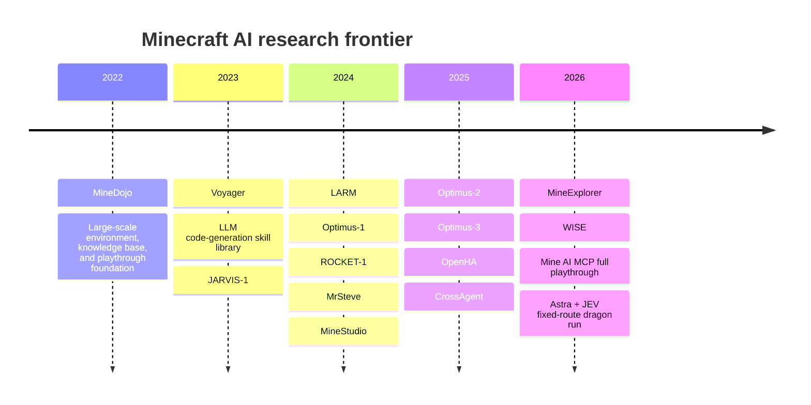

# Minecraft AI Frontier Research Report — 2026-09-28

> English, LLM-optimized edition. This version preserves the source report's claims, numbers, caveats, citations, URLs, code, benchmark definitions, and distinctions between observation/action interfaces, while normalizing terminology and sentence structure for easier machine parsing.

## Executive Summary

As of September 28, 2026, Minecraft AI research is not well described by a single ranking of “how far an AI can progress in Minecraft.” Instead, the field has split into several research lines that differ primarily in the abstraction level of the agent's observation and action interfaces. Four lines are especially important:

1. **Pixel / vision → action systems**, which map rendered visual input to relatively low-level actions.
2. **Tool-assisted / skill-API systems**, which act through semantic interfaces such as Mineflayer, MCP tools, or skill libraries.
3. **Long-horizon memory / planning systems**, which primarily study extended exploration, memory, and planning.
4. **Benchmark / metrics systems**, which make these approaches more comparable.

MineDojo established a large-scale environment, knowledge, and task foundation in 2022. Subsequent work—including Voyager, JARVIS, LARM, Optimus, ROCKET, MrSteve, OpenHA, MineExplorer, and WISE—has progressively subdivided and advanced the research problem. citeturn2search9turn15academia32turn19view1turn19view3

At this point, **the broad claim that “an AI has completed Minecraft from start to finish” has already been demonstrated**. On September 15, 2026, Mine AI MCP published a single approximately 3-hour-57-minute session using Claude Opus 5. The agent began with an empty inventory, entered the Nether, obtained Blaze Rods and Ender Pearls, used Eyes of Ender to search for a Stronghold, entered the End, and defeated the Ender Dragon. The project released the full transcript, SQLite tool log, vanilla server log, and prompt, and the server recorded the `[Free the End]` advancement. This makes it one of the most auditable public full-playthrough examples available at the time of this review. However, the run used a **tool-assisted agent with 388 MCP tool calls across 37 distinct tools**, so it is fundamentally different from pure screen input followed by keyboard/mouse control. The seed was also fixed to `97996358`. citeturn21view0turn21view1

The Astra+JEV system by rmalde defeated the Ender Dragon in 8 minutes 43.3 seconds, but this is closer to a different event category than a directly comparable general-agent result. The run used a fixed seed, a pre-surveyed route, known End Portal coordinates, a naturally active End Portal, Peaceful difficulty, Mineflayer pathfinding, structured block state, a dragon-head sensor, and other privileged components. The final route was also fixed in a configuration file. Therefore, this result is best interpreted as **an experiment in integrating a planner with a fast controller on a known route**, rather than as evidence of general ability to solve an unknown Minecraft world. citeturn11view2turn11view5

On the vision/pixel-oriented frontier, progress has moved in several directions: LARM reached enchanted diamond equipment; Optimus-2 studied atomic, long-horizon, and open-ended tasks; MrSteve focused on exploration using What-Where-When episodic memory; OpenHA/CrossAgent studied more than 800 tasks across multiple action abstractions; Optimus-3 integrated System 1 and System 2 behavior; WISE introduced causal Which-Why memory; and MineExplorer evaluated multi-hop exploration with hidden prerequisites. However, none of the primary-source results reviewed here constitutes a full random-seed playthrough. LARM, for example, selects from a library of 106 GPT-4/Mineflayer skills. Therefore, “the agent uses images” is **not** equivalent to “the agent is a raw keyboard/mouse controller.” citeturn18view0turn19view0turn19view2turn15academia31turn22view0

The central conclusion of this review is therefore:

> **Among the primary sources examined, I did not find a reproducible public demonstration in which an agent autonomously progresses from a fresh spawn to defeating the Ender Dragon under all of the following strict conditions: an unseen random seed; fresh vanilla Survival; no seed or structure coordinates; no pre-surveyed route; no `/locate`; no Mineflayer navigation or semantic skill API; only approximately human-equivalent visual observation and low-level keyboard/mouse control; and no operator intervention.**

This is not proof that no such system exists. It is the conclusion supported by the primary sources reviewed as of the report date. Taken together, the public results suggest that **tool-assisted systems have already reached the Ender Dragon, whereas systems closer to human-equivalent perception/action remain bottlenecked by the integration of long-horizon exploration, spatial memory, failure recovery, and hidden-prerequisite reasoning**. MineExplorer likewise reports that strong MLLMs can perform well on single-hop tasks but degrade sharply when they must coordinate multiple hidden prerequisites, and that simply scaling the model or enabling a thinking mode does not consistently solve the problem. citeturn19view3turn21view1turn18view0

Accordingly, a more research-relevant next frontier is not “defeat the Dragon faster on another fixed seed,” but to measure **success rate across many seeds** on the following progression:

```text
unseen random seed
    ↓
fresh survival spawn
    ↓
Nether entry
    ↓
general fortress exploration
    ↓
blaze acquisition
    ↓
return to own portal
    ↓
pearl acquisition / Eye crafting
    ↓
stronghold localization from Eye observations
    ↓
End entry
    ↓
Ender Dragon
```

The segment `Nether entry → Fortress discovery → Blaze acquisition → portal return` is especially valuable as an independent benchmark. At that point, the problem changes qualitatively from local resource collection to sparse-landmark exploration, spatial memory, and risk management.

At a high level, the research trajectory since MineDojo has shifted from simple task completion toward action abstraction, memory, causal reasoning, and open-world exploration. citeturn2search9turn18view0turn19view1turn19view2turn19view3



## Major Projects and Research Landscape

For projects with papers, the dates below prioritize the **arXiv v1 release date**. For projects centered on a public run, the date refers to the **published run**. If the repository creation date could not be confirmed from primary sources, it is not estimated.

| Project | Release date / period | Main line | Main contribution / positioning | Official URL |
|---|---:|---|---|---|
| **MineDojo** | 2022-06-17 | Benchmark / platform | Integrates a large set of Minecraft tasks, simulation APIs, an Internet-scale Minecraft knowledge base, MineCLIP, and related infrastructure. A foundation for much later work. citeturn2search9turn2search5 | https://github.com/MineDojo/MineDojo |
| **Voyager** | 2023 | Tool / skill-API | A lifelong embodied agent in which GPT-4 generates and accumulates Mineflayer JavaScript skills. A representative tool-assisted system that progresses to diamond tools. Many later projects, including LARM, use it as a comparison point or skill-generation method. citeturn2search29turn18view0 | https://github.com/MineDojo/Voyager |
| **JARVIS-1** | 2023-11 | Hierarchical multimodal | Combines an MLLM planner, multimodal memory, and a goal-conditioned controller, supporting more than 200 tasks. An important direct predecessor to the 2024–2026 line of work. citeturn3academia39turn2search22 | https://github.com/CraftJarvis/JARVIS-1 |
| **LARM** | 2024-05-27 | Vision + skill-API / long horizon | Autoregressively selects the next skill from text, multi-view images, position, inventory, and other state. Uses 106 GPT-4-generated Mineflayer skills and reaches enchanted diamond equipment. citeturn18view0 | Project: https://lizhuoling.github.io/LARM_webpage/ |
| **Optimus-1** | 2024-08-07 | Memory / planning | Introduces Hybrid Multimodal Memory using a hierarchical directed knowledge graph and a multimodal experience pool, improving planning/reflection on long-horizon Minecraft tasks. citeturn3academia40 | Project/paper belongs to the Optimus series |
| **ROCKET-1** | 2024-10-23 | Vision-conditioned control | Addresses the information loss that occurs when a VLM passes only language subgoals to a low-level policy. Uses segmentation of previous images as visual-temporal context for the low-level policy, reporting large gains in open-world interaction. citeturn15academia33 | https://github.com/CraftJarvis/ROCKET-1 |
| **MrSteve** | 2024-11-11 | Long-horizon memory | Introduces Place Event Memory with `what / where / when`, memory navigation, and switching between exploration and task-solving. Targets long-horizon exploration failures in STEVE-1-style low-level controllers. ICLR 2025. citeturn19view1turn20view1 | https://github.com/frechele/MrSteve |
| **MineStudio** | 2024-12-24 | Infrastructure / benchmark | Unifies seven components—simulator, data, model, offline pretraining, online fine-tuning, inference, and benchmarking—into one open-source package. Serves as experimental infrastructure for the CraftJarvis line. citeturn15academia32 | https://github.com/CraftJarvis/MineStudio |
| **Optimus-2** | 2025-02-27 | MLLM + learned control | High-level MLLM planner + Goal-Observation-Action Conditioned Policy. Also releases the MGOA dataset with 25,000 videos, 8 atomic tasks, and approximately 30M goal-observation-action pairs. CVPR 2025. citeturn19view0turn20view0 | https://github.com/iLearn-Lab/CVPR25-Optimus-2 |
| **Optimus-3** | initial 2025-06 line / revised 2026 | Unified System 1/2 | Integrates a fast action loop with deliberative reasoning through Dual-Router Aligned MoE and Dual-Granularity Reasoning-Aware Policy Optimization. The paper reports improvements including 60% success on open-ended tasks. citeturn22view0 | Project: https://cybertronagent.github.io/Optimus-3.github.io/ |
| **OpenHA** | 2025-09-13 | Cross-level action / benchmark | Systematically compares multiple action abstractions/tokenizers across 800+ tasks and proposes Chain of Action, where abstract actions are used as intermediate reasoning before final action generation. Releases code, dataset, and checkpoints. citeturn15academia31 | https://github.com/CraftJarvis/OpenHA |
| **CrossAgent** | 2025-12-10 | Adaptive action abstraction | Trains one model to choose among action spaces of different granularities—API, GUI, low-level, etc.—depending on the situation. Reported to outperform fixed-action-space baselines on 800+ Minecraft tasks. Released through the OpenHA repository. citeturn15academia30 | https://github.com/CraftJarvis/OpenHA |
| **MineExplorer** | 2026-05-29 | Benchmark / exploration | Constructs atomic tasks designed to reduce dependence on Minecraft-specific memorized knowledge, then extends them into implicit multi-hop tasks with hidden prerequisites. Even strong MLLMs degrade sharply on multi-hop tasks. EMNLP 2026 Main. citeturn19view3turn20view2 | https://github.com/meituan-longcat/MineExplorer |
| **WISE** | 2026-06-11 | Causal memory / exploration | Extends What-Where-When memory with Which-Why relations encoded in a Causal Event Graph, plus opportunistic task scheduling and multi-scale exploration. citeturn19view2 | Paper: https://arxiv.org/abs/2606.12852 |
| **Mine AI MCP** | full run: 2026-09-15 | Tool-assisted | Defeats the Ender Dragon from a fresh world using 37 MCP tools and 388 calls. Publishes transcript, SQLite data, server logs, and prompt, giving it unusually strong evidentiary quality among full-playthrough systems. citeturn21view0turn21view1 | https://github.com/aibengineering/mine-ai-mcp |
| **Astra + JEV / rmalde** | as of 2026-09 | Structured skill controller | GPT-6 Astra planner + JEV selector produces an 8:43.300 Dragon run, but uses a fixed pre-surveyed seed, known coordinates, a special active portal, Peaceful difficulty, Mineflayer, and other privileged mechanisms. citeturn11view2turn11view5 | https://github.com/rmalde/minecraft-agent |

**On GROOT.** Among the requested set “Optimus/GROOT/LARM,” this review did **not** identify a formally released Minecraft agent project named **GROOT** in the primary sources searched. Projects named GROOT/GR00T are commonly found in robotics, creating a risk of accidental conflation with Minecraft research. Accordingly, this report does not treat an unverified Minecraft GROOT project as real and keeps it separate from Optimus and LARM.

It is also important not to equate MineDojo with today's notion of a “strict pixel benchmark.” The standard environment can expose not only RGB but also structured observations such as inventory, voxels, and location, and its action/observation configuration is flexible. Therefore, the statement “this system uses MineDojo” is insufficient to determine whether the interface is human-equivalent. The actual observation and action surface must be inspected for each paper or run. citeturn2search13

## Key Papers and Technical Lines

### Pixel / Vision → Action

This category should itself be divided into two distinct settings:

- **strict raw-pixel → raw keyboard/mouse**, and
- **vision-conditioned learned controllers**.

Most current papers are closer to the second category. Seeing the screen is not the same thing as operating through a human-equivalent action interface.

**Optimus-2 — *Multimodal Minecraft Agent with Goal-Observation-Action Conditioned Policy* (2025).** Optimus-2 uses an MLLM as the high-level planner and GOAP as the low-level controller. Inside GOAP, the Action-guided Behavior Encoder compresses the causal relationship between the current observation and action, together with prior trajectory information, into fixed-length behavior tokens. The MLLM then conditions on the language goal and autoregressively predicts actions. A major contribution is the MGOA dataset: 25,000 videos, 8 atomic tasks, and approximately 30 million GOA pairs. The paper reports improvements on atomic, long-horizon, and open-ended instructions, but its evaluation target is not random-seed full-game completion. It therefore does not constitute evidence of reaching the Ender Dragon. citeturn19view0turn20view0

**ROCKET-1 — *Mastering Open-World Interaction with Visual-Temporal Context Prompting* (2024).** ROCKET-1 targets the loss of spatial information that occurs when a VLM sends only language subgoals such as “cut a tree” to a low-level policy. It uses object segmentation with systems such as SAM-2 and historical visual context as prompts to the policy, reporting an approximately 76-percentage-point absolute improvement in Minecraft open-world interaction. The key point is that this is not a system where “the LLM itself presses the keyboard.” It studies a communication representation between high-level visual reasoning and a learned interaction policy. citeturn15academia33

**MrSteve — *Instruction-Following Agents in Minecraft with What-Where-When Memory* (2024 / ICLR 2025).** MrSteve adds Place Event Memory to a STEVE-1-style controller, storing what was seen, where it was seen, and when it was seen over long time horizons, then using that memory to navigate back to relevant places. It switches between exploration and task-solving phases and improves sparse-resource tasks. This is highly relevant to sparse-landmark exploration such as finding a Fortress, but the evaluation is not end-to-end Ender Dragon completion. Its primary memory retrieval mechanism is feature similarity; WISE later targets this limitation by introducing explicit Which-Why causal representations. citeturn19view1turn20view1turn19view2

**Optimus-3 — *Dual-Router Aligned Mixture-of-Experts Agent with Dual-Granularity Reasoning-Aware Policy Optimization*.** Optimus-3 treats System 1 as high-frequency visuomotor control and System 2 as planning, grounding, reflection, and active perception, aiming to integrate both organically inside one agent. It introduces Knowledge-Enhanced Automated Data Generation, Dual-Router Aligned MoE, and Dual-Granularity Reasoning-Aware Policy Optimization. The first page of the paper reports improvements over prior SOTA on planning, captioning, grounding, reflection, long-horizon action, and related tasks, including 60% success on open-ended tasks. However, this “open-ended success” is not equivalent to random-seed game completion. citeturn22view0

### Tool-Assisted / Skill-API Systems

**LARM — *Large Auto-Regressive Model for Long-Horizon Embodied Intelligence* (2024).** Although LARM can superficially look like a vision→action system, its interface is more precisely **vision → skill token → Mineflayer skill**. Text input includes the goal, previous skill, 3D coordinates, inventory, execution result, and other state; the agent also receives four-direction multi-view images. The output skill token is matched against 106 pre-generated skill embeddings, where the skills themselves were generated using GPT-4 and Mineflayer. The ARNTS dataset contains 2,589 samples with annotated dependency graphs, and training includes long-horizon scheduling through mechanisms such as target transmission. LARM reaches enchanted diamond tools, and the appendix includes Nether portal construction and Nether entry, but it should not be treated as a raw keyboard/mouse benchmark. citeturn18view0

**Mine AI MCP (2026).** This project is important less as a conventional research paper than as an implementation and run artifact. Its MCP server exposes semantic tools for inspection, navigation, actions, and other capabilities to an external LLM. Claude Opus 5 completed the game using 388 tool calls. The run proceeds continuously from a fresh spawn through diamond gear, the Nether, blaze rods, 12 pearls, Eye-of-Ender triangulation, a Stronghold, and the End. The agent also recovered its equipment after dying to a Creeper. Its major strength is that it **tests real long-horizon reasoning and failure recovery in a full playthrough**. Its major weakness, for strict embodiment research, is that the MCP runtime heavily abstracts low-level perception and control. citeturn21view1turn21view0

**Astra + JEV / rmalde (2026).** This system separates GPT-6 Astra or another planner from JEV-based action selection, with Mineflayer as the execution layer. Its fastest public run is 8:43.300 and demonstrates a compact loop of roughly 131 JEV decisions and 35 planner calls. However, the run design includes seed `8398967436125155523`, a pre-survey, known End Portal coordinates, a village providing 21 obsidian, a naturally active portal, a Nether shortcut, Peaceful difficulty, and a route fixed in configuration. Its value is therefore in **planner/controller architecture and low-latency integration**, not as a direct comparison to random-seed exploration benchmarks. citeturn11view2turn11view5

**OpenHA — *A Series of Open-Source Hierarchical Agentic Models in Minecraft* (2025).** OpenHA places the core research question on action abstraction: what action granularity is appropriate? After comparing multiple action spaces and tokenizers across more than 800 tasks, it argues that no single granularity is universally optimal. It proposes Chain of Action, where abstract actions are used as intermediate reasoning tokens before final action generation rather than merely as commands to a separate controller. Because the project releases code, benchmarks, curated datasets, and checkpoints, it is an important comparison point for action-abstraction research after 2025. citeturn15academia31

**CrossAgent — *Training One Model to Master Cross-Level Agentic Actions via Reinforcement Learning* (2025).** CrossAgent moves away from a static predefined action space and trains the model itself to choose interaction granularity at each task and step. It uses SFT + multi-turn GRPO to learn cross-level action switching and reports outperforming fixed-action baselines on more than 800 Minecraft tasks. The goal is not strict raw-input purity, but a general agent that can choose high- or low-level interfaces as needed. Code and models are released through the OpenHA repository. citeturn15academia30

### Long-Horizon Memory / Planning

**Optimus-1 — *Hybrid Multimodal Memory Empowered Agents for Long-Horizon Tasks in Minecraft* (2024).** Optimus-1 separates Minecraft knowledge into a hierarchical directed knowledge graph and prior multimodal experiences into an experience pool, then provides both to the planner and reflector. It is important as a memory architecture for maintaining “what should I do next?” over a long technology tree. This is distinct, however, from persistent world-spatial memory or persistent lifelong agent identity. citeturn3academia40

**WISE — *A Long-Horizon Agent in Minecraft with Why-Which Reasoning* (2026).** WISE extends MrSteve's What-Where-When episodic memory by adding explicit causal structure for “which task is this related to?” and “why is this important?” in a Causal Event Graph. It also combines an Opportunistic Task Scheduler—which can reorder tasks when an opportunity is discovered—with multi-scale progressive exploration. Because it improves robust recall under viewpoint changes and sparse long-horizon tasks, its design ideas are directly relevant to Nether exploration and revisit problems. However, based on the arXiv record reviewed here, no official code repository was explicitly confirmed as of 2026-09-28. citeturn19view2

### Benchmark / Metrics Systems

**MineDojo — *Building Open-Ended Embodied Agents with Internet-Scale Knowledge*.** MineDojo established infrastructure for treating Minecraft not merely as a collection of isolated crafting tasks, but as a platform for open-ended embodied intelligence. It provides a large Internet-derived knowledge database and many tasks, including long-horizon Ender-Dragon-related tasks in its Playthrough category. The important caveat is that the benchmark platform's observation space is configurable. A “MineDojo result” alone should therefore not be treated as sufficient evidence of low-level or general-agent performance. citeturn2search9turn2search13

**MineExplorer — *Evaluating Open-World Exploration of MLLM Agents in Minecraft* (2026).** MineExplorer filters atomic tasks to reduce dependence on memorized Minecraft-specific recipes and combines ReAct-style capability units into implicit multi-hop tasks. A multi-agent workflow generates task graphs, sandbox scenes, and rule-based milestone evaluators. The benchmark shows that even strong MLLMs can succeed on single-hop tasks and then collapse sharply as hidden prerequisites accumulate. This is an important direction because it separates “the model knows Minecraft facts” from “the model can explore an unknown world for a long time.” citeturn19view3turn20view2

**MineStudio (2024).** MineStudio's contribution is less a new algorithm than a reproducible common stack spanning simulator, data, training, inference, and benchmarking. MineExplorer also uses an HTTP-controllable sandbox built on MineStudio. This lowers the engineering cost of future comparative experiments. citeturn15academia32turn20view2

## Pixel→Action vs. Tool-Assisted Systems

When asking whether “an AI has beaten Minecraft,” the most important issue is **not only the achievement itself, but also what information was hidden from the agent and what computation the environment or harness performed on its behalf**.

| Line / Project | Publicly demonstrated capability | Observation space | Action space | Seed condition | Privileged tools / state | Reproducibility | Public data |
|---|---|---|---|---|---|---|---|
| **MrSteve** | Improved sparse sequential tasks / exploration | visual observation + episodic memory | STEVE-1/VPT-style learned controller | benchmark-defined | not primarily a raw tool API, but uses a benchmark environment | **High**: code, 100-episode command, and stats script are public | code/log output specification citeturn20view1 |
| **ROCKET-1** | Improved open-world interaction | RGB/visual context + segmentation/tracking | learned low-level policy | task benchmark | visual assistance such as SAM-2 | Medium to high | code/demo public citeturn15academia33 |
| **Optimus-2** | atomic, long-horizon, and open-ended instructions | multimodal observation + history | GOAP learned actions | benchmark tasks | high-level MLLM planner | Medium: official repo exists, but the current README states that it is under refactoring | MGOA: 25k videos / 30M pairs citeturn19view0turn20view0 |
| **Optimus-3** | open-ended tasks and related evaluations; paper reports 60% success | visual + reasoning context | System-1 action + System-2 reasoning | benchmark tasks | learned hierarchical architecture | paper + project available | reports OptimusM-series data citeturn22view0 |
| **LARM** | enchanted diamond equipment; examples include Nether entry | 4-view images + position + inventory + feedback | **106 semantic Mineflayer skills** | task-oriented | **Yes: coordinates, inventory, skill library, Mineflayer** | Medium | paper reports ARTNS with 2,589 samples citeturn18view0 |
| **OpenHA / CrossAgent** | 800+ tasks; cross-level action SOTA claims | multimodal | multiple abstract / raw-ish action spaces | benchmark tasks | depends on abstraction level | **Relatively high**: code/model/data released | benchmark, dataset, checkpoints citeturn15academia31turn15academia30 |
| **Mine AI MCP** | **fresh spawn → Ender Dragon kill** | structured MCP observations | **37 MCP semantic tools** | **public winning run on fixed seed `97996358`** | **Yes: navigation, inspection, and action tools** | **Very high artifact reproducibility**, though gameplay itself is nondeterministic | transcript, SQLite, server log, prompt, video citeturn21view0turn21view1 |
| **Astra + JEV** | **8:43.300 Dragon kill** | structured game state, loaded blocks, etc. | bounded/high-level Mineflayer actions | **fixed, pre-surveyed, special seed** | **Many: known portal coordinates, route, pathfinding, dragon sensor, etc.** | code/tests are public; some generated run media are local/outside the repo | events/test infrastructure, route config citeturn11view2turn11view5 |

A crucial distinction is that **LARM is not a pure pixel→keyboard system**. The paper emphasizes multi-view vision, but the agent's output is a selection among pre-generated skills, not raw keypresses, and the text observation includes the current 3D coordinate and inventory. Therefore, research that “uses visual input” must not be conflated with research on a human-equivalent interface. citeturn18view0

Mine AI MCP, conversely, is important evidence that **long-horizon cognition is already quite strong when semantic embodiment is available**. The agent consistently completed Blaze Rod acquisition, long-distance travel, Eye-of-Ender triangulation, an approximately 1,700-block journey to the Stronghold, item recovery after a Creeper death, End Crystal destruction, and the Dragon kill. This substantially weakens the hypothesis that “LLMs simply cannot maintain a Minecraft plan over several hours.” A more plausible remaining challenge is grounding that reasoning into **visual perception, spatial mapping, and continuous/low-level control without semantic tools**. citeturn21view1

Astra+JEV provides a different insight. If the agent is given sufficient structured state and a known route, planner/controller integration can operate in real time and at very high speed. However, because the run measures very little unseen-seed generalization, it is even farther than Mine AI MCP from a random-seed AGI-style benchmark. citeturn11view2turn11view5

A compact view of the frontier as of September 2026 is therefore:

```text
                         Minecraft AI frontier

  high-level cognition
         ↑
         │           Mine AI MCP
         │              ●  ← full game
         │
         │  Voyager / LARM / OpenHA
         │          ●
         │
         │                   ← integration gap →
         │
         │   MrSteve / ROCKET / Optimus
         │            ●
         │
         └──────────────────────────────────→
             semantic tools         human-like low-level control

 strict target:
 screen / human-equivalent state
           +
 low-level action
           +
 unseen seed exploration
           +
 multi-hour planning/memory
           =
 ???  ← no public verified full-game run found
```

## Open Problems and Proposed Benchmark

The current research gap is not simply that “Dragon combat is difficult.” The core issue is that a fresh-spawn-to-End trajectory contains a sequence of qualitatively different reasoning problems. MineExplorer's sharp performance decline on multi-hop hidden-prerequisite tasks, together with MrSteve and WISE treating long-horizon spatial memory as a distinct problem, is consistent with this view. citeturn19view3turn19view1turn19view2

- **Nether Fortress discovery.** Unlike early Overworld exploration for local resources such as wood, stone, and iron, Fortress search requires sustained exploration for a sparse structure in an unknown 3D space. The agent must simultaneously manage explored regions, direction, verticality, lava, death risk, and the location of its portal. This becomes dramatically easier as soon as the system is given a semantic `locate`, structure coordinates, or a pathfinder, so a serious benchmark requires strict tool restrictions.

- **Returning after exploration.** Finding a Fortress once is insufficient. After obtaining Blaze Rods, the agent must return to its original Nether portal. MrSteve's Place Event Memory and WISE's Causal Event Graph are related to this class of “reuse a previously observed place” problem, but portal-return reliability inside a complete Survival loop remains independently research-worthy. citeturn19view1turn19view2

- **Stronghold localization.** If `/locate` and known coordinates are forbidden, the agent must throw Eyes of Ender from multiple locations, infer a hidden target from directional changes, detect overshooting when necessary, and eventually move underground. This is an active-localization problem. Mine AI MCP recorded actual Eye-based triangulation and an approximately 1,700-block journey, but that result occurred on the MCP observation/action surface. citeturn21view1

- **Long-horizon causal memory.** Vector similarity or simple storage of “what, where, when” can lose the reason an observation mattered—for example, “why did I record this lava pool?” or “which goal chain does this portal belong to?” WISE's Which-Why representation and Causal Event Graph begin to address this gap directly. citeturn19view2

- **Recovery from failure or death.** In a long-horizon benchmark, a local failure should not automatically turn the entire run into a total failure. Mine AI MCP's successful recovery of equipment after a Creeper death shows why recovery should be an explicit metric in full-playthrough evaluation. citeturn21view1

- **Action-abstraction leakage.** A common framework is needed to describe how much planner capability is effectively outsourced by APIs such as `goto(x,y,z)`, `collect(item)`, `craft(item)`, or `findNearestBlock`. OpenHA/CrossAgent are important because they study the action space itself, but a full-game leaderboard would additionally need a manifest describing exactly what information and computation the harness provides. citeturn15academia31turn15academia30

- **Seed generalization.** A single successful run can be strongly affected by a lucky spawn, nearby village, Fortress distance, Stronghold distance, and other world-specific factors. Evaluation should therefore use an undisclosed held-out seed set and report success rates with confidence intervals rather than relying on fixed-seed speedruns.

- **Agent continuity across model swaps.** Among the major Minecraft studies reviewed here, I did not find one that makes it a primary benchmark whether the same agent preserves autobiographical memory, maps, commitments, and world-state understanding after its base LLM/controller is replaced mid-run. For lifelong agents operating in Minecraft over days or months, this is a relatively unexplored cross-cutting gap.

The proposed primary benchmark is the **Random Seed Nether-to-End Benchmark (RSN2E)**. Rather than evaluating Dragon combat in isolation, it decomposes the mid-game sequence where general agent capabilities become especially important.

```yaml
benchmark: Random Seed Nether-to-End

world:
  edition: Minecraft Java
  mode: Survival
  difficulty: Normal
  seed: unseen_random
  seed_visible_to_agent: false
  initial_inventory: empty

forbidden:
  - /locate
  - seed database / ChunkBase
  - pre-surveyed route
  - structure coordinates
  - block/entity coordinate oracle
  - goto(x,y,z) navigation API
  - semantic collect/craft/kill macro
  - operator intervention
  - save-scumming
  - per-seed hard-coded policy

allowed_strict_track:
  observation:
    - rendered first-person RGB
    - normal vanilla HUD
  action:
    - keyboard-equivalent discrete inputs
    - mouse yaw/pitch/buttons
    - inventory UI actions

allowed_assisted_track:
  observation:
    - RGB
    - documented inventory/status metadata
  action:
    - bounded primitive skills
  requirement:
    - every privilege must be declared
```

Success should not be represented only by a single binary variable such as `beat_game`. Instead, evaluation should record a milestone survival curve:

\[
S_k =
\frac{\text{number of runs that reached seed }k}
     {\text{total number of seeds}}
\]

Recommended milestones:

```text
M0  fresh spawn
M1  iron-capable state
M2  Nether entered
M3  Fortress independently discovered
M4  required blaze rods acquired
M5  original/usable portal reached and Overworld returned
M6  sufficient pearls / Eyes obtained
M7  Stronghold localized without coordinate oracle
M8  End portal entered
M9  Ender Dragon defeated
M10 exit portal entered
```

The recommended **standard protocol** is:

- 20 development seeds,
- 30 public validation seeds,
- 100 private/held-out test seeds.

At minimum, paper-level claims should use 100 unseen seeds, and the seed list should remain hidden from the agent developer until evaluation begins. For agents with temperature or sampling randomness, the primary evaluation should use one run per seed, with a subset of seeds repeated three times to estimate variance. Success rates should be reported together with 95% binomial confidence intervals.

At minimum, evaluation should store the following metrics:

| Metric | Meaning |
|---|---|
| `SR_M2 ... SR_M10` | success rate for each milestone |
| `time_to_milestone` | wall-clock time / game ticks to each milestone |
| `action_count` | total number of low-level actions |
| `planner_calls` | number of expensive model-reasoning calls |
| `tokens_in/out` | cognition cost |
| `USD_equivalent` | API-equivalent inference cost |
| `distance_travelled` | exploration efficiency |
| `unique_chunks` | amount of spatial exploration |
| `death_count` | risk/failure rate |
| `recovery_rate` | recovery rate after death or critical failure |
| `revisit_efficiency` | fraction of remembered landmarks that can be successfully revisited |
| `fortress_search_cost` | time/chunks from Nether entry to Fortress discovery |
| `portal_return_rate` | return success after Blaze acquisition |
| `stronghold_localization_cost` | Eye count, distance, throws, and time |
| `human_interventions` | must always be 0 in the strict track |
| `privilege_manifest` | complete list of APIs and structured state exposed to the agent |

Running the same agent under three tracks would help isolate where the architecture is bottlenecked:

```text
Track A: Reasoning ceiling
structured semantic tools
        ↓
“Can the cognition solve the game?”

Track B: Embodied middle ground
vision + bounded reusable skills
        ↓
“Can it explore and orchestrate skills?”

Track C: Human-equivalent
screen + keyboard/mouse
        ↓
“Can it integrate everything?”
```

Mine AI MCP is a very strong reference point for Track A. MrSteve, ROCKET, Optimus, and OpenHA provide technologies that move toward Tracks B and C. If these systems are evaluated on the same seed suite, it becomes much easier to distinguish whether failures come primarily from LLM reasoning or from perception/controller limitations. citeturn21view1turn19view1turn15academia33turn15academia31

## Priority Sources for Reproduction and Implementation

When reproducibility matters, the recommended reading order is:

**run artifact → exact tagged code → benchmark harness → model paper**.

Rather than following only headline achievements in papers, researchers should inspect the code to determine exactly what information and capabilities are exposed to the agent.

### Highest Priority: Mine AI MCP

Mine AI MCP provides the full-playthrough transcript, tool log, server log, and prompt, making it possible to audit in detail what the LLM reasoned about and which tools it depended on. The winning commit is fixed with the `beat-the-game` tag, and the Docker setup pins the base image down to its digest. citeturn21view0turn21view1

```bash
git clone https://github.com/aibengineering/mine-ai-mcp.git
cd mine-ai-mcp
git checkout beat-the-game

docker compose \
  -f compose.yaml \
  -f compose.beatthegame.yaml \
  build

docker compose \
  -f compose.yaml \
  -f compose.beatthegame.yaml \
  run --rm -e RUN_MODE=login play

EULA=true RUN_DIR=./runs/beat-the-game \
docker compose \
  -f compose.yaml \
  -f compose.beatthegame.yaml \
  up --abort-on-container-exit
```

The winning overlay pins seed `97996358`, bot `AI_M1KE`, model `claude-opus-5[1m]`, and effort `high`. The repository explicitly notes that the world/setup can be reproduced, but the LLM gameplay itself is not deterministic. citeturn21view0

To connect only the MCP host to an existing Minecraft server:

```bash
bunx github:aibengineering/mine-ai-mcp \
  --minecraft-host 127.0.0.1 \
  --minecraft-port 25565 \
  --username MineAI \
  --version 1.21.4
```

This requires Bun 1.4+, and the winning-run setup uses Minecraft Java 1.21.4. citeturn21view0

Public dataset:

```text
https://huggingface.co/datasets/aibengineering/beat-the-game-minecraft
```

The dataset includes `transcript.jsonl`, `stream.full.jsonl`, `bot-data.sqlite`, server logs, and related artifacts. The Hugging Face viewer may display a session wrapper as a single row, but the dataset card states that the underlying `transcript.jsonl` contains 1,121 records: 731 assistant turns, 388 tool results, system initialization, and the final result. citeturn21view1

### MineExplorer

MineExplorer is a high-priority source when the goal is to compare the **exploration capability** of frontier models in isolation. A ready-to-use Docker sandbox is public. citeturn20view2

```bash
git clone https://github.com/meituan-longcat/MineExplorer.git
cd MineExplorer

docker run -d \
  --name mineexplorer \
  -p 8000:8000 \
  davidzhth/mineexplorer:0.0.1

curl http://localhost:8000/monitor/alive

export MC_SANDBOX_URL=http://localhost:8000
```

Representative benchmark-generation and evaluation commands are published in the repository: citeturn20view2

```bash
python generate_benchmark.py multi \
  --model aws.claude-opus-4.6 \
  --num-samples 10 \
  --k-min 1 \
  --k-max 1 \
  --candidate-num 1 \
  --output benchmark_new

python eval_benchmark.py \
  --model aws.claude-opus-4.6 \
  --benchmark-dir benchmark_new \
  --output-dir results \
  --num-workers 10 \
  --resume
```

The repository also contains `benchmark/`, `benchmark_hard/`, `eval_benchmark.py`, `generate_benchmark.py`, videos, and related material. The sandbox is built on MineStudio and supports scene reset, commands, and first-person screenshot acquisition over HTTP. citeturn20view2

### MrSteve

MrSteve has particularly high reproduction value when comparing memory/exploration behavior against a new agent. Its repository explicitly provides a 100-episode evaluation command and a statistics script. citeturn20view1

```bash
git clone https://github.com/frechele/MrSteve.git
cd MrSteve

uv sync
uv run -m pip install git+https://github.com/MineDojo/MineCLIP
uv run -m pip install gym==0.21.0

uv run bash prepare_models.sh

uv run main.py \
  task=log_water_bucket_aba_randinit \
  agent=mrsteve \
  n_episodes=100

uv run scripts/get_stats.py \
  outputs/log_water_bucket_aba_randinit/mrsteve/*
```

This 100-episode style is also informative for designing the Random Seed Nether-to-End benchmark. The important methodological idea is to evaluate an **architecture as an episode distribution**, not as a single best run.

### rmalde / Astra+JEV

This repository is valuable not as a general-agent baseline, but as an engineering reference for planner/controller separation, run verification, and a real-time evidence pipeline. The public execution example is: citeturn11view5

```bash
git clone https://github.com/rmalde/minecraft-agent.git
cd minecraft-agent

npm install
./start-server.sh

node optimization/nether/freeze-run.mjs NEW_RUN

PLANNER_MODEL=openai/gpt-6-astra \
RUN_ID=NEW_RUN \
NATIVE_VIEW=1 \
WAIT_NATIVE=1 \
NATIVE_RECORD=1 \
DRAGON_SENSOR_URL=http://127.0.0.1:3093 \
node nether-agent.mjs

python3 native-client/launch.py
```

Verification tests:

```bash
node --test \
  evidence.test.mjs \
  native-mirror.test.mjs \
  optimization/*.test.mjs \
  optimization/pass-2/policy.test.mjs \
  optimization/nether/*.test.mjs
```

However, to use this repository as an RSN2E baseline, a separate ablation track would have to remove the fixed route in `optimization/nether/config.json`, known coordinates, Peaceful difficulty, dragon sensor, and related privileged components. Otherwise the comparison would not be fair. citeturn11view2turn11view5

### MineDojo / MineStudio / OpenHA

```bash
git clone https://github.com/MineDojo/MineDojo.git
git clone https://github.com/CraftJarvis/MineStudio.git
git clone https://github.com/CraftJarvis/OpenHA.git
git clone https://github.com/CraftJarvis/ROCKET-1.git
git clone https://github.com/iLearn-Lab/CVPR25-Optimus-2.git
```

MineDojo provides official native-install and Docker instructions. MineStudio was released as an integrated framework spanning simulator through benchmark. The OpenHA paper explicitly states that code, datasets, and checkpoints are released. The official Optimus-2 repository exists, but its June 2025 README states that Optimus-1/2 are being refactored to align with the Optimus-3 framework. Reproduction should therefore strongly prefer pinned commits/versions. citeturn2search17turn15academia32turn15academia31turn20view0

For research use, every run should save the equivalent of the following `manifest.json` at startup:

```json
{
  "minecraft_version": "1.x.x",
  "agent_commit": "<git sha>",
  "world_seed_hash": "<hidden until evaluation ends>",
  "difficulty": "normal",
  "observation_surface": [
    "rgb"
  ],
  "action_surface": [
    "keyboard",
    "mouse"
  ],
  "privileged_state": [],
  "semantic_tools": [],
  "planner_model": "...",
  "controller_model": "...",
  "max_wall_time_sec": 28800,
  "operator_interventions": 0
}
```

Making this manifest mandatory would substantially reduce the problem of grouping together agents that only see the screen with agents that receive coordinates, inventory, loaded blocks, and semantic navigation under the same label of “Minecraft AI.” Primary sources make clear that LARM, Mine AI MCP, and rmalde use fundamentally different observation/action interfaces. citeturn18view0turn21view0turn11view2

## Public Runs, Logs, and Verifiable Evidence

When evaluating public achievements, it is not enough to look for a YouTube video. A stronger standard asks whether **machine-readable traces and server-side evidence** exist.

| Evidence | Contents | Verification value |
|---|---|---|
| **Mine AI MCP HF dataset** | full session, prompt, tool calls, metadata | Very high citeturn21view1 |
| `transcript.jsonl` | 1,121 records, 731 assistant turns, 388 tool results | decision trajectory can be reanalyzed citeturn21view1 |
| `bot-data.sqlite` | action requests, outcomes, notes, etc. | enables tool-level causal analysis citeturn21view0turn21view1 |
| vanilla `minecraft-server.log` | `[Free the End]` advancement | kill evidence independent of the agent's own self-report citeturn21view1 |
| Mine AI result evidence | `dragon_died`, entity disappearance, dragon egg / exit portal generation | multiple independent completion signals citeturn21view1 |
| `beat-the-game` Git tag / Docker | winning source + pinned environment | high setup reconstructability citeturn21view0 |
| MineExplorer output | rule evaluator, episode video, result/message output | useful for auditing benchmark episodes citeturn20view2 |
| MrSteve `outputs/` + stats | episode-level logs and aggregates | useful for multi-episode evaluation citeturn20view1 |
| rmalde verification infrastructure | `events.jsonl`, tests, victory/evidence pipeline | useful reference for route-level verification design; some generated recordings may remain local/outside the repo citeturn11view5 |

The evidence for the Mine AI MCP run is particularly strong. The run spans 2026-09-15 00:43:30 to 04:40:21 UTC, uses vanilla Minecraft 1.21.4, seed `97996358`, Claude Opus 5 with a 1M context window, and 388 tool calls across 37 distinct MCP tools. The dataset card estimates an API-equivalent compute cost of approximately USD 93.17. The actual run was performed through a subscription, so this number is **not** the actual billed amount. citeturn21view1

The agent's own notes are also notable. They preserve the sequence `fresh spawn → diamond gear → Nether blaze rods → 12 overworld pearls → stronghold → End`, and record an approximately 1,700-block journey after Eye-of-Ender triangulation. This suggests that **an LLM can potentially handle Stronghold localization strategically without semantic `/locate`**. However, perception and movement still occurred through MCP tools, so this does not yet establish the same capability under a strict embodied interface. citeturn21view1

If this evidentiary standard is transferred to a future Random Seed benchmark, the minimum public evidence package should include:

```text
server log
+
full agent transcript
+
every observation
+
every action
+
world seed commitment/hash
+
agent source commit
+
model identifier
+
environment/container hash
+
milestone timestamps
+
uninterrupted video
```

A hash commitment recorded before revealing the seed after evaluation would also reduce concerns that only favorable seeds were pre-selected.

The current frontier can be summarized as follows. Mine AI MCP has pushed

\[
\text{long-horizon planning with semantic embodiment}
\]

close to full-game level. MrSteve, WISE, and MineExplorer isolate the difficulty of

\[
\text{exploration + memory + hidden prerequisites}
\]

while the Optimus/ROCKET/OpenHA line improves

\[
\text{vision} \rightarrow \text{action abstraction} \rightarrow \text{control}.
\]

However, among the primary sources reviewed here, there is still no full-playthrough evidence integrating all of the following in a single agent:

\[
\boxed{
\text{unseen world}
+
\text{human-equivalent perception}
+
\text{low-level control}
+
\text{multi-hour causal memory/planning}
}
\]

citeturn21view1turn19view1turn19view2turn19view3turn15academia31

In this sense, **Random Seed Nether-to-End is not merely a reimplementation of existing work. It is a benchmark that integrates frontier capabilities that are currently being solved separately.**

## Prompt Templates for Giving This Report to an LLM

### Template A — English Translation of the Original Japanese Template

```text
Treat the following Minecraft AI frontier research report as research context.

Objective:
Design and evaluate a general embodied agent that can solve Minecraft Survival
on unseen random seeds under approximately human-equivalent observation and
action constraints, progressing from a fresh spawn through the Nether,
Fortress, Stronghold, and End.

Important constraints:
- The seed is hidden from the agent.
- No pre-surveying.
- No /locate.
- No structure/block/entity coordinate oracle.
- No semantic macros such as goto/collect/craft/kill.
- No operator intervention.
- In the strict track, observation is limited to first-person RGB + vanilla HUD.
- In the strict track, only keyboard/mouse-equivalent low-level actions are allowed.
- Pretrained Minecraft knowledge is allowed.
- Persistent memory is allowed.
- Model-based planning is allowed.

Analyze especially:
1. The fundamental differences from existing methods.
2. Exploration strategies for Nether Fortress discovery.
3. Memory for returning from a Fortress to the portal.
4. Stronghold localization using Eyes of Ender.
5. Long-horizon causal memory / What-Where-When-Which-Why representations.
6. Responsibility separation between the planner and low-level controller.
7. Failure/death recovery.
8. Evaluation over 100 unseen seeds.
9. Architectures that approach existing SOTA without semantic tools.
10. Ablation-study design.

Do not focus on a single successful video.
Prioritize milestone success rate, confidence intervals, time, action count,
token/cost, death/recovery, and exploration efficiency.

The research report follows:

<REPORT>
[INSERT THE FULL REPORT HERE]
</REPORT>

First classify the problem into three categories:
- parts already solved by existing research,
- parts that remain unsolved,
- parts that could become novel research contributions.

Then provide the smallest implementation roadmap and an experiment matrix.
```

### Template B — Existing English Template, Normalized for LLM Readability

```text
Treat the following Minecraft AI frontier research report as the primary
research context for this task.

Research objective:
Design and evaluate a general embodied agent that can progress from a fresh
spawn through the Nether, fortress acquisition, stronghold localization,
the End, and ultimately the Ender Dragon on unseen random Minecraft
Survival seeds under approximately human-equivalent observation and action
constraints.

Strict-track constraints:
- The world seed is hidden from the agent.
- No seed-specific pre-surveying.
- No /locate.
- No structure, block, or entity coordinate oracle.
- No semantic goto/collect/craft/kill macros.
- No human/operator intervention.
- Observation is limited to first-person RGB and ordinary vanilla HUD
  information.
- Actions are limited to keyboard/mouse-equivalent low-level controls.
- Pretrained Minecraft knowledge is allowed.
- Persistent external memory is allowed.
- Model-based planning is allowed.

Focus your analysis on:
1. The real capability gap relative to existing Minecraft agents.
2. General exploration for Nether Fortress discovery.
3. Remembering and returning to the original Nether portal.
4. Stronghold localization from repeated Eye of Ender observations.
5. Long-horizon causal memory, including
   What-Where-When-Which-Why representations.
6. Responsibility boundaries between the deliberative planner and
   low-level controller.
7. Failure and death recovery.
8. Evaluation over at least 100 unseen seeds.
9. Architectures that approach current SOTA without privileged semantic
   tools.
10. A rigorous ablation-study design.

Do not optimize for a single lucky successful run.
Prioritize milestone success rates, confidence intervals, time to milestone,
low-level action count, inference/token cost, death/recovery rate, and
exploration efficiency.

Research report:

<REPORT>
[INSERT THE FULL REPORT HERE]
</REPORT>

First classify the problem into:
(A) capabilities already demonstrated by prior work,
(B) capabilities that remain unsolved,
(C) capabilities that could constitute a novel research contribution.

Then propose the smallest viable architecture, implementation roadmap,
and experiment matrix capable of testing the central research hypothesis.
```
